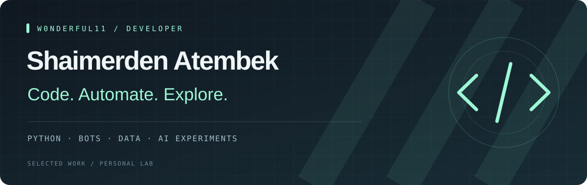

  

  <strong>PYTHON &nbsp; / &nbsp; AUTOMATION &nbsp; / &nbsp; DATA</strong> 
  Building useful tools. Exploring what comes next.

 

### 01 / About

I'm **Shaimerden**, a developer working with Python, Telegram bots and data analytics. My projects explore practical automation, databases and AI-powered interfaces.

### 02 / Selected work

<table>
<tr>
<td width="50%" valign="top">
<h3>↗ Service Desk Bot</h3>

Telegram-based ticket management with MongoDB storage, reports and Excel exports.

<code>Python</code> <code>Aiogram 3</code> <code>MongoDB</code>

<a href="https://github.com/W0nderful11/service_desk_bot"><strong>Explore project →</strong></a>
</td>
<td width="50%" valign="top">
<h3>↗ Olist Analytics</h3>

E-commerce data exploration with PostgreSQL, analytical queries, dashboards and monitoring.

<code>Python</code> <code>SQL</code> <code>Grafana</code>

<a href="https://github.com/W0nderful11/olist-ecommerce-analytics"><strong>Explore project →</strong></a>
</td>
</tr>
<tr>
<td colspan="2" valign="top">
<h3>↗ AI Canvas / Hackathon</h3>

An experiment based on the tldraw Agent Starter Kit: natural-language canvas editing, media generation and collaborative video features.

<code>TypeScript</code> <code>tldraw</code> <code>AI integrations</code>

<a href="https://github.com/W0nderful11/hackaton"><strong>Explore project →</strong></a>
</td>
</tr>
</table>

### 03 / Toolbox

| Build | Data | Explore |
| :--- | :--- | :--- |
| Python · Aiogram | PostgreSQL · MongoDB | TypeScript · tldraw |
| Telegram bots · Automation | Pandas · SQL | AI integrations |
| Docker · Git | Grafana · Prometheus | Web interfaces |

<strong>Learning archive</strong>

 
Earlier repositories include university assignments, web fundamentals and discrete mathematics exercises. They document the learning process; the projects above are the starting point for exploring my work.

 

<strong>W0NDERFUL11</strong> &nbsp; · &nbsp; Always a work in progress.

